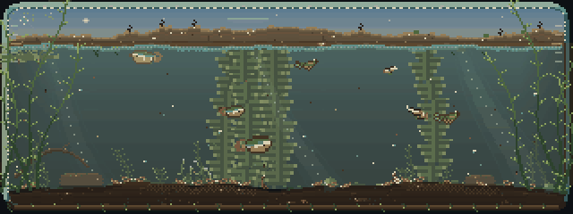
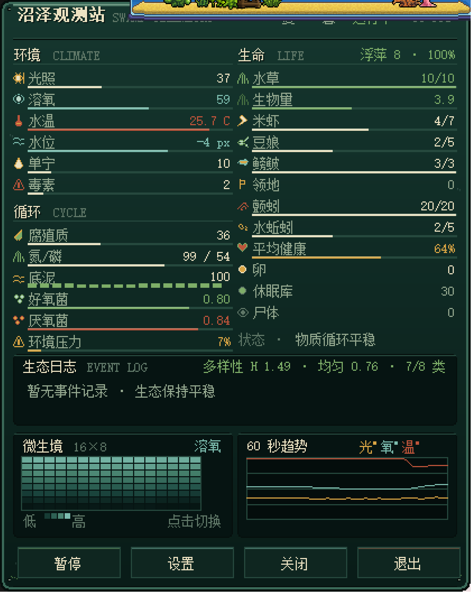
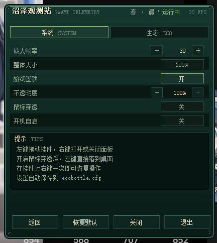
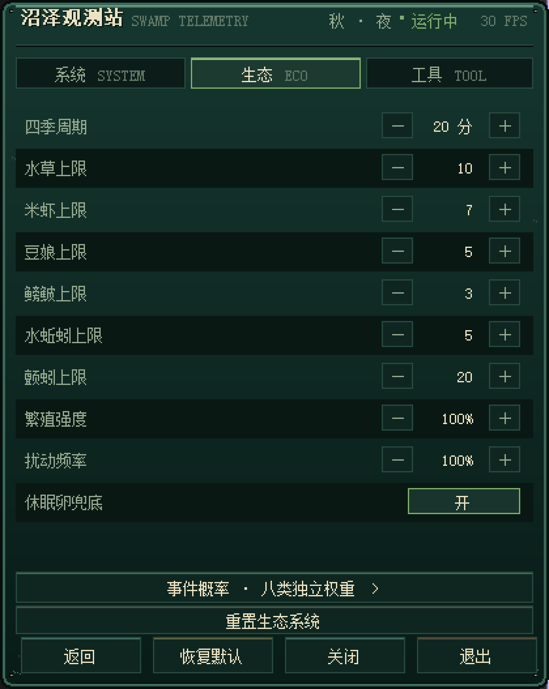
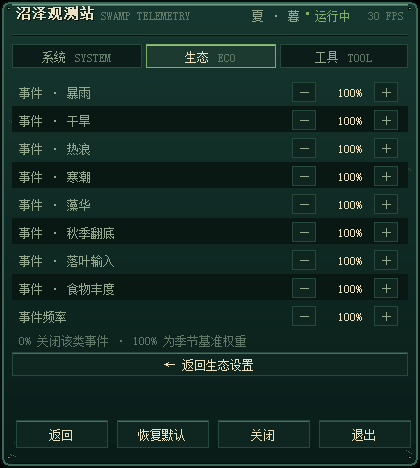

# Mossglass · 苔痕生态瓶

> 320×120 的桌面生态瓶：会呼吸，会枯荣，也会在你关掉白天之后继续过夜。

[](https://isocpp.org/)
[](https://www.libsdl.org/)
[](LICENSE)
[](#依赖)

**Mossglass** is a 320×120 always-on-top desktop ecosystem bottle for Windows, written as a single-file C++17 + SDL2 program. It loads no images, fonts or audio: every leaf, glyph, fish and snowflake is drawn by code. A rounded glass jar, an uneven living shore, a self-closing food web and a persistent evolving state — a small aquarium that keeps living while you work.

一个 320×120 的 Windows 桌面悬浮像素生态瓶。圆角立体玻璃缸、起伏的岸线与岸上灌木、外缘透明、始终置顶；不是全屏游戏。



- 标准 C++17，仅依赖 SDL2 与 Windows 系统库；运行时完全不加载任何图片 / 字体 / 音频素材（`icon.ico` 只在编译时作为 exe 资源嵌入，不参与渲染）
- **五类动物 + 水草群落**：米虾、豆娘稚虫、鳑鲏小鱼、水蚯蚓、颤蚓（红虫），以及生产者水草与水面浮萍
- **主食物链**：水草群落 / 水面浮萍 → 米虾 → 豆娘稚虫 → 鳑鲏
- **碎屑食物链**：腐殖质/残体 → 颤蚓 → 米虾幼体 / 豆娘稚虫幼体
- 每个动物独立计算位置、速度、能量、年龄、生长值、健康、年龄阶段与遗传性状
- 水草以**群落**为单位：低矮草丛 / 高杆水草 / 莲座浮叶草，各自有幼苗、成长、成熟、衰老和枯萎阶段
- 捕食存在体型门槛；捕食者优先选择体型匹配、容易捕获的猎物
- 动物死亡不直接消失：进入沉降、翻身/腹部朝上、褪色、淡出的尸体流程，最后转化为腐殖质
- 水草枯萎不直接删除：先褪色、倒伏、收缩，再转化为腐殖质和养分
- 桌面环境联动：CPU 负载、键鼠闲置、系统主音量、笔记本电池，最多每秒采样一次
- 柔和昼夜光照、极慢季节水位、附生藻类、成鱼领地、底泥肥力分层与血脉色偏标记
- 30 fps 默认上限（可在设置中调整为 15–60 fps）；像素水草与动物均有缩放、染色和死亡动画
- **右键像素观测站**：玻璃仪表盘风格，实时显示环境 / 循环 / 生命全量数据、生态事件日志与 Shannon 多样性、16×8 微生境热图、60 秒三线趋势与暂停 / 关闭 / 退出按钮
- **像素设置面板**：系统 / 生态 / 工具三页，可调帧率、整体大小、置顶、不透明度、鼠标穿透、开机自启、四季周期、物种上限、繁殖与扰动强度、休眠兜底，以及八类生态事件各自的触发权重（生态页二级“事件概率”页）；配置自动保存到 `ecobottle.cfg`
- **演化状态自动保存**：每 5 秒原子写入 `ecobottle.state`，退出时再存一次；重启后季节、昼夜、物种、卵库、微生境与随机数流全部接着演化，直接关机最多只丢 5 秒
- **单实例运行**：重复启动会直接唤醒已运行的程序并退出新进程，不会出现两个瓶子和两份存档
- **八类非致死生态事件**：暴雨、干旱、热浪、寒潮、藻华、秋季翻底、落叶输入、食物脉冲；只改变环境强迫量，不直接杀死任何个体
- **合乎逻辑的物种延续**：不凭空生成成体；每类物种保有一份休眠繁殖体（种子、休眠卵、胞囊），某个物种空缺、或只剩不可繁殖的幼体时只补充这份“银行”，之后仍要经过孵化、幼苗、成长等正常环节才能重新成体。休眠卵兜底开关可关闭这一补充
- **更从容的繁殖节奏**：米虾、豆娘、鳑鲏的繁殖能量门槛、能量消耗与冷却时间均已放宽，衰老速度下调；低密度时休眠卵更容易孵化，长期挂机时不易越养越空。捕食、饥饿与缺氧仍按原有逻辑生效
- **岸线与水体布局**：瓶口内侧是一条永久起伏的远岸，岸顶在 13–22px 之间自然波动；水面随季节在 26–44px 之间升降，即使涨到最高也仍低于岸线最低点，所以水永远不会与上面的土地齐平或漫过陆地。底部泥床同样保留 1–2px 的缓慢起伏，两侧不堆高土坡
- **远岸与河床是两种土**：远岸用偏浅、偏暖的干黏土色板，带水平层理、碎石亮点、干裂纹和稀疏枯草茬；底部泥床保持深色湿泥与琥珀色淤泥斑。远岸靠近水面的一行会重新变暗，像被水浸湿的岸脚。灌木根系还会把岸顶拱起 1–2px，岸线随植被生长有很轻微的高低变化
- **动态天空**：瓶口空气带按一日相位与季节着色——黎明 / 黄昏是暖橙地平线，白天是浅青蓝，深夜转为靛蓝并浮现星点；春绿、夏金、秋锈、冬冷蓝各有一层季节色。白天太阳沿弧线从左到右移动，云团成组缓慢漂移、下雨时云层加厚变灰并加速；星点在雨夜自动减淡。天空整体绘制在岸线与灌木之后，不会遮住灌木，只有雨、热浪等天气粒子会叠在前景
- **岸上灌木独立演化**：岸线灌木是独立于水体的生命系统，春发、夏盛、秋变锈色并结籽、冬落叶休眠；老株会枯死，成熟株在秋季就近落籽，空岸在来年春天重新萌发。最多 12 丛，并保留至少 5 丛的硬保证：数量不足时会从休眠根重新抽芽，任何季节都不会彻底消失。每丛高度只占上方天空带的约四分之一到三分之一，不会挡住天空。它不读取也不写入溶氧、腐殖质、氮磷或任何动物数据
- **浮萍是真正的生态成员**：水面浮萍以独立小种群演化，随季节生长与衰退，吸取水中的氮、磷（带下限，不会把水抽干），密集时最多遮掉沉水水草 22% 的光照；米虾游到水面会啃食浮萍并补充能量，鳑鲏在饥饿时也会上浮啄食（每次一小口，冷却很长），啃食会减少浮萍的密度但不会把它吃光。浮萍数量与密度会写入存档；冬季每丛缩成一个小休眠芽，其余季节最差也只会缩成薄薄一层小叶，任何季节都不会整丛消失；不足两丛时会自动补种，来年春天重新铺开
- **浮萍与环境要素的耦合**：浮萍白天在水面做少量光合作用、夜间呼吸更弱，对溶氧的贡献被刻意压在主水草群落之下，只能轻微推高读数；密集浮萍只压暗上层约四行水体的光照（最多 30%），不影响底层；浮萍簇正下方为幼虾、幼豆娘提供结构庇护，捕食成功率最多再降 45%；暴雨会打散浮萍、热浪会加速它生长，两者都只调整质量增速，不会整丛抹除；三种水草株型随季节小幅轮替（幅度仅 ±15%），属于缓慢演替而非枯死
- **河岸是单向的水体补贴源**：岸土记录湿度——降雨浸润、干旱与热浪失水、春夏有保底残湿；湿度超过田间持水量时，才向水体缓慢渗出极少量氮、磷与腐殖质。秋季落叶量由岸上灌木的现存叶量与成熟度决定，岸丛越茂盛落叶越多；岸上枝叶只遮蔽水面下最上面两行光照（最多 8%）；暴雨冲刷岸土会让近岸表层单宁轻微上升（整体仍被暴雨稀释）；夏季成熟岸丛偶尔掉落昆虫，给表层鱼虾一次小点心。全部都是“陆地 → 水体”的单向输入，灌木依然不读取溶氧、氮磷或任何动物数据，单次输入量都远低于水草吸收与随机事件的强度
- **个体档案与放置造景**：右键面板的工具页可点选任意个体查看 ID / 阶段 / 年龄 / 能量 / 健康 / 生长 / 附生藻 / 基因，也可在瓶内摆卵石、沉木、贝壳或清除；工具只在面板打开时生效，关闭面板即恢复原有拖拽 / 惊扰 / 投喂 / 滚轮光照

## 文件

| 文件 | 说明 |
| --- | --- |
| [`ecobottle.cpp`](ecobottle.cpp) | 完整源码：像素美术、环境采样、生态/遗传/群落、渲染、窗口与主循环 |
| [`app.rc`](app.rc) | Windows 资源脚本，把程序图标编进 exe |
| [`icon.ico`](icon.ico) | 程序图标，16 / 24 / 32 / 48 / 64 / 128 / 256 多尺寸内嵌 |
| [`build_mingw.bat`](build_mingw.bat) | MinGW-w64 一键编译脚本 |
| [`LICENSE`](LICENSE) | 本项目源码的 MIT 许可证 |
| [`LICENSE-SDL2.txt`](LICENSE-SDL2.txt) / [`LICENSE-winpthreads.txt`](LICENSE-winpthreads.txt) | 随附运行库的原始许可证 |
| [`preview.png`](preview.png) | 4× 最近邻放大静态预览 |
| [`preview.gif`](preview.gif) | 动画预览（2×） |
| [`preview_panel.png`](preview_panel.png) | 右键像素观测面板实拍 |
| [`preview_settings.png`](preview_settings.png) | 系统设置页实拍 |
| [`preview_settings_eco.png`](preview_settings_eco.png) | 生态设置页实拍 |
| [`preview_settings_events.png`](preview_settings_events.png) | 事件概率页实拍 |
| `ecobottle.cfg` | 自动生成的设置文件（首次退出时创建，已加入 `.gitignore`） |
| `ecobottle.state` | 自动生成的演化状态快照（运行 5 秒后出现，周期更新，已加入 `.gitignore`） |
| `EcoBottle.exe` + `SDL2.dll` + `libwinpthread-1.dll` | 本地编译产物，不纳入版本库；按下方步骤自行构建 |
| `README.md` | 本说明 |

## 依赖

- Windows 10 / 11（x64）
- SDL2 **2.0.16+**（实测 2.32.10）
- MinGW-w64 GCC（实测 8.1.0）或 MSVC 2019 / 2022
- 不需要 SDL2_image、SDL2_ttf、SDL2_mixer
- 主音量读取使用 Windows Core Audio，链接 `ole32` 与 `uuid`（系统自带）

## 编译（MinGW-w64）

```bat
build_mingw.bat C:\SDL2\x86_64-w64-mingw32
```

或：

```bat
windres app.rc -O coff -o app.res
g++ -std=c++17 -O2 -Wall -Wextra ecobottle.cpp app.res -o EcoBottle.exe ^
    -I "C:\SDL2\x86_64-w64-mingw32\include\SDL2" ^
    -L "C:\SDL2\x86_64-w64-mingw32\lib" ^
    -lmingw32 -lSDL2main -lSDL2 -lgdi32 -luser32 -lole32 -luuid -ladvapi32 -mwindows ^
    -static-libgcc -static-libstdc++

copy "C:\SDL2\x86_64-w64-mingw32\bin\SDL2.dll" .
copy "C:\mingw64\bin\libwinpthread-1.dll" .
EcoBottle.exe
```

## 编译（MSVC 2019 / 2022）

```bat
cl /nologo /std:c++17 /O2 /EHsc /I SDL2\include\SDL2 ecobottle.cpp app.rc ^
   /link /LIBPATH:SDL2\lib\x64 SDL2main.lib SDL2.lib ole32.lib uuid.lib advapi32.lib ^
   /SUBSYSTEM:WINDOWS

copy SDL2\lib\x64\SDL2.dll .
EcoBottle.exe
```

## 操作

| 操作 | 效果 |
| --- | --- |
| 左键按住拖动 | 移动生态瓶窗口 |
| 右键瓶子 | 打开 / 关闭像素观测面板 |
| 右键面板 / `Esc` | 关闭观测面板 |
| 点击面板外任意位置 | 自动收起观测面板；包括桌面、任务栏和其它程序窗口上的点击 |
| 面板“设置” | 进入系统 / 生态 / 工具三页 |
| 工具页“个体档案” | 之后在瓶内左键点选个体，面板显示其档案；点空白处取消 |
| 工具页“放置造景” | 之后在瓶内左键放置卵石 / 沉木 / 贝壳，或选用“清除”移除 |
| 面板“退出” | 弹出确认框，确认后保存配置与演化状态并结束程序 |

**工具不会干扰日常办公**：档案与造景仅在右键面板打开、且工具页选中对应工具时才接管瓶内左键；关闭面板（右键 / `Esc` / “关闭” / 点击面板外）会立即清空工具与选择，左键恢复拖拽、惊扰、`Shift` 投喂与滚轮调光的原行为。

开启“鼠标穿透”时，面板一打开就会暂时收起穿透（让面板与瓶内工具能接到鼠标），面板关闭后自动恢复；`click_through` 设置本身不会被任何交互改写，重启后仍按用户的开关生效。

窗口隐藏任务栏按钮；面板内“退出”、`Alt+F4` 或关闭窗口都会走正常退出流程并自动存档。重复启动 exe 时，第二个进程会立即退出并把已运行的窗口带到前台。

## 右键像素观测面板

右键生态瓶会弹出一块独立的 420×528 置顶分层窗口，全部内容由软件像素绘制，不加载图片或字体文件。中文标签使用系统 SimSun 12/15px 位图字，阈值化后缓存为 1-bit 掩码，因此保持像素颗粒感。



**位置与跟随**：优先放在瓶子上方 8px；上方放不下时自动改到下方，再不够则放到左右侧；拖动瓶子时面板实时跟随，关闭后淡出。

**实时数据**

- 头部：季节、昼夜阶段、运行/暂停状态、平滑 FPS
- 环境：光照、溶氧、水温、水位偏移、单宁、毒素
- 循环：腐殖质、养分、底泥 16 段肥力柱、好氧菌、厌氧菌、环境压力
- 生命：水草、水草生物量、米虾、豆娘、鳑鲏、领地、颤蚓、水蚯蚓、平均健康、卵、休眠卵库、尸体；标题右侧另显示浮萍丛数与覆盖率
- 状态提示：根据溶氧、毒素、单宁、健康、虾群/鱼群空缺给出当前最需要关注的一条

**生态日志与多样性**

- 日志条记录最近 8 次生态事件（暴雨 / 干旱 / 热浪 / 寒潮 / 藻华 / 秋季翻底 / 落叶输入 / 食物丰度），面板显示最新 3 条：事件名、进行中或距今时间、强度百分比
- 已完成的事件保留在缓冲区里，新事件覆盖最旧一条；重启程序后日志从空开始（只是观察记录，不参与任何模拟计算）
- 右侧实时显示 Shannon 多样性指数 `H` 与均匀度：把矮草 / 高杆 / 莲座三种水草株型和米虾 / 豆娘 / 鳑鲏 / 水蚯蚓 / 颤蚓五类动物共 8 组，按个体数占比计算
- 均匀度 > 0.72 显示苔绿，0.45–0.72 琥珀，更低锈红；不足 8 组时会额外标出 `N/8 类`，用于判断群落是否失衡

**微生境热图**

- 16×8 网格，5 个图层：溶氧 / 光照 / 单宁 / 毒素 / 密度
- 点击热图或在其上滚动滚轮切换图层
- 以网格均值与自身标准差自适应色阶，始终呈现局部差异，单个极值不会冲淡整体

**60 秒趋势**

- 1 Hz 采样，滚动 60 秒
- 三条折线：光照（琥珀）、溶氧（青）、水温（锈红）
- 面板打开前也在后台采样，打开即可看到最近一分钟

**面板按钮**

| 按钮 | 效果 |
| --- | --- |
| 暂停 / 继续 | 暂停或恢复生态演算（观测面板继续刷新） |
| 关闭 | 淡出面板，瓶子继续运行 |
| 退出 | 弹出确认框；确认后自动保存并结束程序 |

面板重绘限制在 20 Hz，瓶子主循环仍保持可配置的帧率上限。

## 设置面板

设置页复用同一块 420×528 像素窗口，通过顶部“系统 / 生态 / 工具”三个标签切换。所有控件都是自绘像素按钮：步进器 `− / +`、开关胶囊、缩放胶囊。



**系统页**

| 项目 | 范围 | 说明 |
| --- | --- | --- |
| 最大帧率 | 15–60 fps，步进 5 | 主循环按该帧率动态休眠；默认 30 |
| 整体大小 | 100% / 200% | 最近邻整数放大，窗口从 320×120 变为 640×240 |
| 始终置顶 | 开 / 关 | 关闭后不再每秒强制置顶 |
| 不透明度 | 50–100%，步进 5 | 通过分层窗口 `SourceConstantAlpha` 调整整窗透明度 |
| 鼠标穿透 | 开 / 关 | 开启后左键直接落到桌面，挂件上右键一次即可恢复；面板打开期间自动暂缓（见工具页），关闭面板后自动恢复，设置值本身不会被改写 |
| 开机自启 | 开 / 关 | 写入 / 删除当前用户的 `HKCU\...\CurrentVersion\Run\EcoBottle`，无需管理员权限 |

**生态页**



| 项目 | 范围 | 说明 |
| --- | --- | --- |
| 四季周期 | 5–60 分钟 | 一个完整季节循环的时长，默认 20 分钟 |
| 水草 / 米虾 / 豆娘 / 鳑鲏 / 水蚯蚓 / 颤蚓上限 | 水草 3–16、米虾 1–14、豆娘 1–10、鳑鲏 1–6、水蚯蚓 1–10、颤蚓 2–32 | 即时生效；降低上限不会清除超额个体；水草下限为 3，保证三种株型可同时保底 |
| 繁殖强度 | 25–200% | 缩放繁殖冷却与休眠卵补充速度 |
| 扰动频率 | 0–300% | 缩放低频自然扰动概率，100% 为原始强度 |
| 休眠卵兜底 | 开 / 关 | 开启时，某类物种空缺或没有可繁殖成体超过 20 秒，其休眠卵 / 种子 / 胞囊库至少补到 1；之后仍按正常孵化与成长流程恢复。关闭后不再补充，物种可能真正消失 |
| 事件概率 | 二级页 | 进入“事件概率”页，单独调节八类生态事件的权重与总触发节奏 |
| 重置生态系统 | 按钮 | 弹出二次确认框；确认后清空全部动植物、卵库、尸体与演化进度，立即重开一缸新生态，并马上写入 `ecobottle.state` |

- “重置生态系统”不动任何设置项，`ecobottle.cfg` 与当前面板打开状态都保持原样；取消或按 `Esc` 只关闭确认框。
- 重置同时清空观测面板的 60 秒趋势与个体档案选择，避免显示上一缸的旧读数。

**事件概率页**（生态页底部“事件概率 · 八类独立权重 >”进入，`← 返回生态设置` 退出）



| 项目 | 范围 | 说明 |
| --- | --- | --- |
| 事件 · 暴雨 / 干旱 / 热浪 / 寒潮 / 藻华 / 秋季翻底 / 落叶输入 / 食物丰度 | 各自 0–300%，步进 10 | 只改变八类事件之间的相对比例；0% 表示该类事件完全不再触发，100% 为该季节的原始基准权重 |
| 事件频率 | 0–300% | 缩放生态事件的整体触发节奏，0% 即关闭全部随机事件 |

- 权重与季节基础权重相乘后归一化抽取，因此某类事件调到 0% 不会让其它事件变得更频繁，只是不再抽到它。
- 同一时刻仍最多存在 3 个事件，已在进行的事件类型不会被重复抽中。

**工具页**

| 项目 | 说明 |
| --- | --- |
| 关闭工具 | 交还瓶内左键，恢复拖拽 / 惊扰 / 投喂 / 滚轮调光 |
| 个体档案 | 瓶内左键点选任意个体，下方卡片实时显示档案；点空白处取消 |
| 放置造景 | 卵石 / 沉木 / 贝壳 / 清除，瓶内左键即放置或移除 |
| 收起工具 | 返回遥测页，同时交还瓶内左键 |

- 设置修改后立即保存并应用，无需重启。
- “恢复默认”一键还原全部系统与生态项（不触碰当前这缸生态）。
- 想重开一缸，用生态页“重置生态系统”并二次确认即可，无需退出程序或手动删文件。
- 低帧率下画面更省电；暂停且无交互时跳过整帧绘制。

### 配置文件 `ecobottle.cfg`

程序在自身目录读写该文件，格式为 `键=值`：

```ini
max_fps=30
scale=100
topmost=1
opacity=100
click_through=0
auto_start=0
season_minutes=20
max_plants=10
max_shrimp=7
max_fish=3
max_damsel=5
max_worms=5
max_tubifex=20
breeding=100
disturbance=100
refuge=1
event_frequency=100
event_weight_rain=100
event_weight_drought=100
event_weight_heat=100
event_weight_cold=100
event_weight_bloom=100
event_weight_overturn=100
event_weight_leaf=100
event_weight_food=100
```

文件缺失时使用默认值；读取时会自动夹紧到允许范围。开机自启写入的是当前 exe 的完整路径，每次启动都会刷新该值；如果移动了程序目录，重新开关一次即可。

### 演化状态文件 `ecobottle.state`

设置与演化进度分开保存：`ecobottle.cfg` 存全部设置项，`ecobottle.state` 存这缸生态本身的演化进度。

- 运行期间每 **5 秒**自动写入一次；正常退出（面板“退出” / `Alt+F4` / 关闭窗口）时再补写一次。
- 先写 `ecobottle.state.tmp`，成功关闭后再用 `MoveFileEx(REPLACE_EXISTING | WRITE_THROUGH)` 原子替换正式文件，断电或强行结束进程也不会留下半截文件。
- 快照包含：季节 / 昼夜相位、水温、溶氧、腐殖质、氮磷、底泥 16 段肥力、全部动植物个体（唯一 ID、位置、能量、年龄、生长、健康、基因）、卵与休眠卵库、尸体、正在进行与冷却中的生态事件、已放置的造景、16×8 微生境网格、惊扰场 / 食物脉冲 / 光斑，以及随机数生成器状态。岸上灌木与水面浮萍各自作为独立小数据块附在随机数状态之后，最后再附一个岸土湿度值。因此重启后环境、种群、造景、岸上植被、浮萍与后续演化序列都从原处继续；旧版存档没有这些块时仍可正常载入，岸上会从默认的灌木重新开始，浮萍则恢复到初始的六丛，岸土湿度回到中性值。
- 未正常退出（直接关机、结束进程）时，下次启动会回到最近一次快照，**最多丢失 5 秒**演化。
- 状态文件带版本号与结构布局校验；旧版本或布局不兼容的存档会被安全丢弃并新开一缸，不会读入错位数据。
- 想重新开始，在“设置 → 生态”点“重置生态系统”并确认，或退出程序后删除 `ecobottle.state`；删除 `ecobottle.cfg` 则恢复默认设置。

## 鼠标拓展交互（仅光标在挂件内生效）

| 操作 | 效果 |
| --- | --- |
| 左键轻点（位移 < 5 像素） | 以落点生成圆形惊扰场；米虾/幼体最敏感，豆娘中等，鳑鲏低敏感，颤蚓/水蚯蚓不受影响；只触发起应激逃跑，不扣血 |
| 左键拖动（位移 ≥ 5 像素） | 切换为窗口拖拽；惊扰场不再生成，原有拖拽逻辑保留 |
| Shift + 左键轻点 | 在落点投放少量沉降有机碎屑；局部小幅增加腐殖质/养分，米虾和颤蚓趋向觅食，不触发惊吓 |
| 鼠标滚轮上/下 | 以光标为中心增强/减弱局部光斑；光斑随时间缓慢消退，并参与局部光照与生物决策 |

- 惊扰有每只个体独立冷却，连续点击不会无限叠加。
- 投喂有 0.55 秒冷却、最多 3 个食物脉冲；腐殖质/养分进入原上限，不会过投。
- 光斑最多 3 个，单次变化有上下限，约 8 秒自然消退。
- 水草、尸体、卵不受惊扰类点击影响。
- 上述瓶子内交互仍直接作用于生态状态机；只有右键打开观测站并在工具页选中“个体档案 / 放置造景”时，左键才被工具接管，关闭面板立即恢复。

## 生态学事件（全部非致死）

事件按季节加权随机触发，拥有淡入 / 淡出包络，同一时刻最多 3 个；它们只改变环境强迫量（水位、水温、光照、溶氧收支、氮磷、腐殖质、单宁、毒素、附生藻），死亡仍只由个体健康归零决定。

| 事件 | 主要影响 |
| --- | --- |
| 暴雨 | 水位上升、光照降低、溶氧与氮输入增加、单宁被稀释 |
| 干旱 | 水位下降、水温略升、溶氧与养分输入减少 |
| 热浪 | 水温升高、溶氧饱和下降、磷释放增加 |
| 寒潮 | 水温下降、代谢按 Q10 变慢、溶氧略升 |
| 藻华 | 透光下降、白天产氧增加而夜间耗氧更凶、氮磷被消耗、附生藻大增 |
| 秋季翻底 | 底泥释放氮磷与腐殖酸、溶氧下降、微量毒素 |
| 落叶输入 | 腐殖质与单宁缓慢进入水体 |
| 食物脉冲 | 细碎屑周期性落入水中，形成可觅食的食物脉冲 |

- 未引入疾病、寄生等会直接暴毙的选项。
- 事件频率与八类事件各自的权重可在“设置 → 生态 → 事件概率”中调整（频率 0% 关闭全部随机事件；单个事件 0% 只停用该一类）。季风、翻底等按季节加权，因此不会在同一季节反复出现。

## 个体档案

- 每个水草群落与每只动物在出生时获得唯一递增 ID，跨存档保持稳定。
- 在工具页选中“个体档案”后，用左键点选瓶内任意个体即可读取：种类与 ID、阶段、年龄、能量、健康、生长、附生藻，以及基因性状（水草为高度 / 密度 / 遮光 / 啃食，动物为体型 / 速度 / 耐氧 / 温度 / 谱系偏移）。
- 卡片每秒随个体状态实时刷新；个体凋亡后保留最后一帧读数并给出提示，点空白处取消选择。
- 悬停时瓶内会出现浅色四角框，标出这一击实际会命中的个体；水草按整根株型列判定（点击叶片即可，不必点根部），鱼虾按身体轮廓判定。
- 读取档案是纯观察行为：不会惊扰个体、不会改变能量或健康。

## 放置造景

- 卵石：低矮圆石，局部略微富集营养；沉木：带分叉的枯枝，局部遮光；贝壳：半埋扇形，缓慢释放少量磷。
- 工具开启时，瓶底会显示琥珀色落点预览框，标明下一件造景将落在哪里；“清除”则显示红色叉号。
- 最多保留 8 件造景，超过后最早放置的一件被替换；选用“清除”后点击瓶内该造景所在的横向位置即可移除（造景始终贴在底床，竖向不必精确）。
- 造景只影响局部微生境（光照 / 营养），不阻挡游动、不参与碰撞。

## 物种延续

- 每个物种都有独立回补：米虾、豆娘、鳑鲏、水蚯蚓、颤蚓，以及矮草 / 高杆 / 莲座三种株型水草。
- 该物种（或该株型）活动个体归零后，只要有休眠繁殖体（种子 / 休眠卵 / 胞囊），就会按正常流程孵化、长出幼苗并成长为成体；不再凭空补入成体。
- “休眠卵兜底”开启时，空缺或无可繁殖成体超过 20 秒后把该物种的繁殖体库至少补到 1，让恢复有材料可用；关闭后不再补充，长期空缺就可能真正灭绝。
- 因此种群数量仍会自然波动甚至短时归零，恢复速度取决于孵化条件（溶氧、光照、食物、繁殖体库），而不是硬性注入。

## 初始规模与上限

以下为默认上限，全部可在“设置 → 生态”中调高（括号内为可调范围）：

- 水草群落：初始 9 簇，默认上限 10 簇（3–16）
- 米虾：初始 6 只，默认上限 7 只（1–14）
- 豆娘稚虫：初始 2 只，默认上限 5 只（1–10）
- 鳑鲏：初始 2 条，默认上限 3 条（1–6）
- 水蚯蚓：初始 4 条，默认上限 5 条（1–10）
- 颤蚓：初始 14 条（4 个小集群），默认上限 20 条（2–32）
- 同时存在的尸体：最多 10 具

## 生态模块

### 颤蚓 / 碎屑链

- 每个颤蚓只有 8×8 像素，红线状，远小于米虾幼体；初始分成 4 个小集群贴在泥面、衰老水草根部。
- 只吃底泥腐殖质与残体，不啃活水草；底泥肥力高时繁殖、集群变多，上限 20 条。
- 米虾幼体、豆娘稚虫幼体会在泥面捕食颤蚓；颤蚓自身不进入主捕食链。
- 缺氧时健康缓慢下降，死亡后身体发白、僵直停在泥面，复用统一尸体→腐殖质→底泥管线。

### 柔光昼夜与趋光

- 全局光照以约 8 分钟为周期缓慢明暗变化，只调整色调和亮度，不做黑屏。
- 水草颜色随光照变化；成熟水草簇根部有柔和阴影。
- 鳑鲏偏好中等亮度：高光时会游向成熟水草阴影；豆娘在高光时长期伏在草茎阴影里，光照降低才外出巡游捕猎。
- 水草生长继续读取原有耐阴基因；耐阴值高的个体在弱光下仍能缓慢生长。

### 附生藻与米虾清洁

- 水草、鱼、虾、豆娘体表可缓慢积累淡绿色附藻斑点；上限受控，不会铺满水体。
- 水草附藻会降低光合作用与生长；动物附藻会提高能耗、降低游速，并略微提高被捕获概率。
- 米虾会主动靠近带藻水草、鱼、豆娘，啃除附藻；清理后自身获得少量能量与生长值，附藻斑点随之减少。

### 成鱼领地

- 只有成体鳑鲏建立领地；领地优先选在成熟水草附近。
- 领地鱼在小范围来回巡逻，同种成鱼闯入时会追逐、推挤，不捕食同类。
- 体型、速度、耐氧综合更强的个体更容易守住领地；领地内繁殖能量门槛更低。
- 领地鱼有极淡的暖色鳍部偏移，巡逻/追逐行为本身可直接观察。

### 鳑鲏重叠与频繁转向修复

- 同一时刻一个成熟水草区只允许一个成体领地，避免两只鱼抢占同一点。
- 领地鱼只驱赶“没有领地”的成鱼；两个领地持有者互相忽略，不再互相追逐形成死循环。
- 目标猎物保持 0.9–1.5 秒再重新评估，避免每帧切换目标导致原地反复掉头。
- 两条鱼身体中心保持约 24 像素软间距，不再重叠成一团。
- 领地鱼能量低于阈值会主动放弃领地与追逐，先休息/觅食；不会再因长时间追逐耗尽而死。
- 追逐推挤只发生在非领地成鱼闯入时，不会捕食同类。

### 底泥养分分层

- 底泥使用 16 段独立肥力值，与水体养分/溶氧分开；画面底部颜色随肥力从浅土棕到深棕渐变。
- 尸体、枯萎水草先进入腐殖质，再缓慢矿化到底泥；水草根部持续消耗所在位置的底泥肥力。
- 肥力过低的地块很难再萌发新幼苗；富集区更容易长出新的水草群落。

### 季节缓变

- 默认约 20 分钟一个完整季节周期（设置中可调 5–60 分钟），水位缓慢下降/回升，水面线和透明度随之变化。
- **季节色调**：整瓶水色随季节渐变——春偏嫩绿、夏偏暖金、秋偏锈褐、冬偏冷蓝，季节交替时平滑过渡；左上角有 5×5 季节图标（春芽/夏日/秋叶/冬雪）。
- **水位可读**：水面两侧有 ±2 格刻度；丰水时水面升入气腔，枯水时露出带干裂纹的泥岸，枯水期水面最多下降约 26px。
- **水色贴合泥岸**：水体色调（昼夜、季节、藻华、温差）按列填充到程序化泥床轮廓 `groundY(x)` 为止，不再用一个固定底边的矩形，因此水与土之间不会出现横向割裂的直线。
- **物候**：春季生长 ×1.10、夏季 ×1.00、秋季 ×0.86、冬季 ×0.58，冬季水草生长与产氧明显放缓，但不会被冻死。
- 枯水时水位下降，高杆水草顶端微微露出水面，溶氧略低，筛选耐氧个体；鱼、虾、豆娘的活动层会跟随水面下移，不会浮在空气中。
- 丰水时水位回升，水体带入少量养分，底泥肥力上升，水草繁殖更快；不会瞬间改变生态。
- **天气粒子**：暴雨有斜向雨丝与水面落点，热浪有横向热浪带，寒潮/冬季低温在玻璃边与底部结霜，藻华有绿色水幕与悬浮藻点，秋季翻底有上浮底泥颗粒，落叶季与落叶事件有飘落叶片，春季有花粉。

### 血脉色偏

- 携带明显优势变异（大体型/高速度/高耐氧）的个体带极淡的暖橙/冷蓝色偏；后代继承这一弱标记。
- 纯观察用：不参与捕食、生长、繁殖或生存判定。

### 杂食兜底

- 仅在极高饥饿阈值触发：鳑鲏会少量啃食水草嫩叶；豆娘在严重缺食时有极低概率捕食体型差距很大的同类幼体。
- 捕食者在猎物稀少时的代谢惩罚已调低（鳑鲏 1.00 → 0.55，豆娘 1.20 → 0.60），避免“猎物少 → 饿死 → 更少”的螺旋把整缸清空。
- 正常状态下，主链捕食规则不变。

## 进阶微生境仿真

### 16×8 网格微生境

- 水体内维护 16 列 × 8 行独立格子：局部光照、溶氧、养分、单宁、厌氧毒素、好氧菌、厌氧菌、局部密度、猎物气味、告警气味、繁殖气味。
- 扩散只在每 30 帧执行一轮；生物每帧只读取所在格子的缓存值。原有 16 段底泥数组保留为兼容备份。
- 局部水体色差以低透明度格子叠加渲染，表现为：富氧偏清、贫氧偏暗、高单宁偏琥珀茶色、高毒素偏锈褐。
- 水草遮光、底泥耗氧、表层复氧会自然形成草甸区、表层富氧区、底层还原区的分区。

### 局部密度与胁迫叠加

- 每个格子统计同物种密度；同种越密，能耗越高、生长越慢、繁殖成功率越低。
- 幼苗在母簇附近高密度时受遮光/养分竞争，容易发黄夭折。
- 缺氧、高单宁、高毒素、高密度、错误水层、温度不适会叠加成 `stress`：先亚健康、停止繁殖和生长，长期才逐步消亡，不会瞬间暴毙。

### 单宁 / 腐殖酸

- 枯萎残体、尸体、腐殖质缓慢释放单宁；相邻格慢扩散。
- 单宁降低局部透光，压制附生藻；适度单宁降低应激；过高单宁造成慢性健康损耗。
- 水草旺盛区缓慢降解单宁。水体叠加琥珀茶色，浓度越高越深。

### 化学踪迹

- 米虾、颤蚓释放短时猎物气味；豆娘稚虫沿邻格梯度巡游，和视觉捕食并行。
- 鳑鲏捕食/追逐时释放告警气味；幼虾、幼豆娘感知后散开或躲草。
- 成体释放弱繁殖气味；只在内部改变决策，不渲染图形。

### 垂直分层

- 鳑鲏偏表层/中上层，豆娘偏中层草茎，米虾中下层，颤蚓/水蚯蚓底泥界面。
- 长期停留在非偏好水层会因水层胁迫缓慢损失健康；底层低氧、厌氧毒素也进入胁迫计算。

### 繁殖位点与附着卵

- 成体达到能量条件后还需要找到匹配水草位点才产卵；卵绑定草茎位置。
- 米虾卵偏高杆草茎，豆娘卵偏近底草茎，鳑鲏卵偏领地草根缝隙。
- 卵有独立 6×6 像素簇精灵；附藻会降低孵化率，米虾会主动清理卵表附藻。
- 孵化率读取卵所在格子的局部溶氧、单宁、光照。
- 原有卵库保留为低种群备用来源，让恢复不必依赖成体再次相遇。

### 幼虾集群

- 幼虾在食物充足且无告警时向同伴质心靠拢，形成松散小群；告警或饥饿时散开。
- 群体提供捕食稀释：周围幼虾越多，单次被捕获概率越低。

### 微生物双层分解

- 每格独立好氧菌/厌氧菌。高溶氧好氧菌快速分解腐殖质为养分；低氧厌氧菌占优并缓慢产生弱毒素。
- 毒素过高使底栖生物、扎根水草亚健康；尸体/残体输入驱动微生物起伏。水蚯蚓原有分解逻辑保留并叠加。

### Q10 温度与耐受基因

- 温度随季节缓慢变化（约 16–26°C）；所有代谢、生长、繁殖、分解按 Q10≈2 响应。
- 温度升高时水体溶氧饱和上限下降。
- 新增独立温度耐受基因，随繁殖遗传变异；温度不适进入胁迫计算。

### 演化权衡

- 大体型：耐氧更高、体型优势，但能耗高、繁殖间隔长、缺食更易死。
- 高游速：追捕/逃逸更好，但基础代谢显著更高。
- 耐阴水草：弱光生长好，但强光下光合上限降低。
- 温度耐受也通过代谢/胁迫代价参与选择，避免单一完美基因垄断。

### 低频自然扰动

- 每轮网格更新极低概率触发局部落叶输入（腐殖质+单宁）或底泥小扰动（局部毒素）。
- 只影响一小块区域，随后由扩散、微生物和水草缓慢恢复，不是全局灾难。

### 休眠传播体

- 每个物种（水草、米虾、鳑鲏、豆娘、水蚯蚓、颤蚓）都有独立休眠卵 / 种子 / 胞囊池。
- 活动个体归零时，兜底只保证繁殖体池至少有 1（空缺 20 秒后补充），孵化仍受当地溶氧、光照、食物与温床条件限制。
- 因此活动种群会自然波动，恢复有先后快慢，而不是直接把成体放进缸里。

## 观测、昼夜与季节行为

### P0 观测层

- 纯观察，不参与任何模拟计算：最近 8 条生态事件日志、Shannon 多样性指数与均匀度、16×8 微生境热图（溶氧/光照/单宁/毒素/密度）、60 秒光照/溶氧/水温三线趋势。
- 具体交互见上文“右键像素观测面板”。

### P1 夜间底层缺氧微层

- 模拟入夜后表层光合停止，最底 2–3 行格子叠加一段很薄的溶氧亏欠（最多约 5.5 点饱和度），白天自动消失。
- 底层生物因此获得一点额外的慢性胁迫，但这一项上限刻意压低，只能让原本就缺氧的区域更明显地亚健康，**不会单独造成死亡**。
- 底层低氧时，米虾、豆娘稚虫、鳑鲏的漫游目标会被轻微向浅水方向抬升（最多 6 像素）；正在捕猎、受惊或濒死的个体不受影响。

### P2 昼夜垂直迁移与警戒信息素

- **垂直迁移**：白天鱼偏中上层、豆娘偏中层、米虾偏中下层；入夜后三者都缓慢下沉，贴近水草与泥面歇息。位移只是游动目标的偏置（鱼 ±10 px、豆娘 ±8 px、虾 ±5 px），不会瞬移，也不覆盖捕猎与逃逸。
- **警戒信息素**：鳑鲏捕食或追逐时仍在所在格释放气味，但单格浓度封顶 2.0，长期追逐不会累积成整缸恐慌。
- 幼虾只有在气味浓度 > 0.18 且最近的鱼在 60 像素以内才会反向逃开；豆娘仅在气味 > 0.30、自身未成年，且 70×45 像素内确有鱼时才躲草。脱离距离后气味继续按原速率衰减，反应自然停止，不会来回抖动。

### P3 夏季热分层与冠层光竞争

- 水温高于 23°C 起，水面与底层的溶氧交换最多放慢 10%（26°C 时达到上限）；热浪会短暂加深这一效应，水温回落后自动恢复。该系数只削弱混合，不会让底层单独变成无氧。
- 盛夏高杆水草对矮草的遮光系数由 0.25 提高到最多 0.30（仅对矮草生效，且只在高温期生效），形成轻微的冠层竞争；秋冬自动回落，不会长期压制某一株型。

## 天空、岸上灌木与移动稳定性

### 一日与四季的天空

- 空气带颜色由模拟内的一日相位（480 秒一轮）与季节相位共同决定，不依赖桌面键鼠闲置状态：太阳高度低时地平线偏暖橙（黎明 / 黄昏），正午是浅青蓝，太阳落到地平线以下转为靛蓝夜色并浮现少量闪烁星点。
- 太阳在白天沿一条小弧线从左侧升到右侧落下，位置始终被限制在玻璃口与远岸之间；云团由多层柔边像素组成，成组缓慢漂移，暴雨时云层变厚、变灰并明显加速；雨夜星点自动减淡。
- 季节色叠加在昼夜色之上：春偏绿、夏偏金、秋偏锈、冬偏冷蓝。昼夜与季节切换都是连续渐变，不会突然跳色。
- 顶部两角按圆角玻璃的内轮廓裁切，天空不会溢出瓶身；天空在远岸与灌木之前绘制，因此云和天色永远不会盖住灌木，只有雨丝、热浪等天气粒子作为前景叠加。
- 瓶口不再有横跨天空的垂苔、顶叶、顶缘藻膜等顶部装饰性边框植物；**左右两侧的边框芦苇保留**，仍然越过瓶口为挂件勾边，只是不再有横向植物挡住天空。
- 浮萍以独立种群的位置与密度每帧绘制，不再烘焙在固定行，随季节涨落一起上下浮动，下面的细根丝会垂进水里；莲座浮叶草的叶盘同样骑在当前水面上，不再挂在旧的固定行。

### 水面浮萍

- 浮萍是水面上唯一的自由漂浮生产者，最多 8 丛，密度用 0.05–1.25 的质量值表示。它随季节律动：春季快速铺开、夏季维持、秋季变薄、冬季每丛缩成一个小休眠芽（不会整季消失），来年春天重新长满。
- 它从水体里吸收少量氮与磷，并受光照与温度影响；吸收带下限，因此不会把水柱抽成贫瘠状态。
- 浮萍密集时会遮掉沉水水草最多 20% 的光照，但不会让水草停止生长。
- 米虾游到水面附近会啃食浮萍补充能量，啃食量与冷却时间都有限，密度被啃低后浮萍需要时间重新长回来。
- 密集的浮萍会就近分出新的一小丛，但总数不超过 8 丛；低于 2 丛时每 8 秒从休眠芽补一丛，避免彻底消失。
- 浮萍种群与密度随存档保存（附在灌木块之后），旧档缺少该块时从默认六丛开始。

### 独立的岸上灌木

- 岸生灌木是一份独立的小型种群（最多 12 丛），只读取季节相位与自身年龄；**不读取也不写入**溶氧、腐殖质、氮磷、毒素、光照或任何水生生物数据，因此水里的系统怎么波动都不会影响岸上。
- 每丛灌木的根会把岸顶抬高 1–2px（离株心越远越小，最高不超过 2px），所以岸线会随植被生长有轻微的高低起伏，但不会长成明显的土丘。
- 它们长在上方远岸的岸顶，以天空为背景，每丛高度只有上方天空带的大约四分之一到三分之一，不会挡住天空。
- 生命周期：春季萌发与快速长高 → 夏季维持 → 秋季叶色转锈并就近落籽 → 冬季落叶休眠、老株可能枯死。成熟株在秋季每 50–95 秒尝试落一粒种子，若 16px 内没有别的灌木就长出新苗。
- 不会灭绝：存活数量低于 5 丛时，每 6 秒会从休眠根抽出一株新芽（任何季节都生效），因此岸线最多只是变稀疏，不会永久光秃。这是岸上植被自身的恢复，不涉及水体保底。
- 灌木状态随存档一起保存（附加在随机数状态之后的小数据块），旧版存档没有该块时照常载入并从默认六丛开始。

### 游动目标与边界

- 米虾、豆娘、鳑鲏的所有游动目标（水草位置、气味邻居、食物脉冲、受惊反向点、领地巡逻点）都会夹紧到本物种实际可达的水域：米虾 9–295、豆娘 11–293、鳑鲏 14–290；目标水深下限统一为“当前水面 + 2px”。
- 这样目标不会再落到墙外或水面以上，避免到达判定永远不成立、贴墙每帧翻转速度造成的高速左右抖动，以及被顶在水面后速度归零造成的原地不动。
- 鳑鲏的夜间抬头 / 昼夜垂直偏置只在新目标生成时施加一次，不再逐帧累加；领地驱逐的推力改为有上限的单次推挤；三种动物的速度都加了硬上限。

## 动物阶段与遗传

每个动物有三个阶段：

| 阶段 | 视觉尺寸 | 行为 |
| --- | --- | --- |
| 幼体 | 最小 | 游得慢、耐受力差、不会繁殖、更倾向躲进水草 |
| 亚成体 | 中等 | 可以觅食和躲避，但还不能繁殖 |
| 成体 | 标准 | 可繁殖 |

- 生物持续进食积累 **生长值**，达到 35% / 70% 才进入亚成体 / 成体。
- 繁殖只发生在成体，并要求能量、溶氧、光照、食物/植物条件合适。
- 每个个体继承亲代的 **体型、速度、耐氧** 三个性状，并产生小幅随机变异：
  - 体型：影响像素尺寸、基础耗能、寿命和繁殖间隔
  - 速度：影响游动和躲闪速度
  - 耐氧：低氧时健康下降更慢
- 捕食有体型门槛：鳑鲏不会捕食过小的幼体；豆娘稚虫也优先捕食达到尺寸的米虾。捕食者会综合距离、猎物尺寸和速度选择目标。
- 水草越密，捕食成功率越低；幼体和豆娘更倾向贴近草丛。

## 水草群落

水草不再以单株小草计数，而是 **群落 / 水草带**：

| 型别 | 轮廓 | 生态位 |
| --- | --- | --- |
| 低矮草丛 | 贴近底泥、覆盖地面 | 为幼虾和小型生物提供低层躲藏 |
| 高杆水草 | 向上形成中上层草带 | 鱼、豆娘和米虾在附近活动 |
| 莲座浮叶草 | 宽叶贴近水面 | 形成水面层次和局部庇护 |

每个群落有：

- **幼苗簇**：低矮、叶片少、庇护弱
- **成长簇**：中等高度、叶片增加
- **成熟簇**：高大茂密、光合作用强、庇护强
- **衰老簇**：颜色变暗、叶片稀疏、部分倒伏

群落遗传性状：高度、密度、耐阴、抗啃食。子群落从母株扩散，继承性状并小幅变异。

- 成熟群落提高局部溶氧；密度过高会因遮光和空间竞争衰弱。
- 每种株型（矮草/高杆/莲座）有独立休眠种子。某株型最后一批成体枯死时，会在原位置补入 1 粒同型种子；条件合适约 24 秒后发芽，不会因为其他株型还活着就永久失去高杆草。
- 米虾在草缘啃食嫩叶/受损部分，降低植物能量和健康；单口啃食只做“修剪”，不会在几十秒内吃光整片草甸。
- 植物健康低时叶片变稀、颜色偏灰黄或褐；死亡时先进入枯萎倒伏，再转化为腐殖质和养分。
- 植物层仍然使用内嵌 `const` 像素数组，不加载外部图片；植物群落默认上限 10，可在设置中调整，避免性能下降。

## 死亡与尸体

- **濒死阶段**：健康低于 0.30 时动物体色逐渐苍白；健康低于阈值后行为改变，而不是瞬间消失。
  - 米虾 < 0.25：停止觅食，缓慢下沉到近底泥处小幅摆动。
  - 鳑鲏 < 0.28：失去平衡，贴近水面缓慢漂移，停止捕食。
  - 豆娘稚虫 < 0.25：停止捕食，贴附最近的水草茎秆随水摆动。
  - 所有物种健康 < 0.40 时不再繁殖；鱼、豆娘在虚弱时也不再捕食。
- **米虾**：停止活动、褪色、翻身向下沉降。
- **鳑鲏**：停止摆尾、颜色变暗、腹部朝上，缓慢下沉/漂移。
- **豆娘稚虫**：停止活动、缓慢沉落、褪色。
- **水蚯蚓**：停止蠕动、僵直在底泥。
- **幼体/亚成体**：使用对应缩小尺寸的死亡流程。
- **水草**：褪色、倒伏、收缩，最后转化。

尸体在沉降期间正常绘制，但不再参与捕食、繁殖或移动；同时最多 10 具，超限时最旧的先转化。尸体在约 8 秒后转入腐殖质与底泥肥力。

## 物质循环与环境

- **光照**：CPU 负载映射，0–100；影响水草生长、溶氧和动物活跃度。
- **溶氧**：水草光合作用产氧，所有生物呼吸耗氧，水面交换缓冲。
- **腐殖质**：尸体、排泄物、啃食碎屑进入腐殖质池。
- **养分**：水蚯蚓把腐殖质矿化为养分，水草吸收；水草繁殖也消耗养分。
- **磷**：腐殖质矿化时同步释放溶解态磷，贝壳缓慢补磷，水草枯萎后把组织里的磷交还水体；底泥同时充当磷缓冲库，水体缺磷时缓慢解吸、富磷时重新吸附。水草按李比希最小因子同时受氮、磷限制，但吸收速率低于补给，因此磷池会在中位附近自行平衡，不再单向流失到底。
- 鱼、豆娘、虾的卵在条件恢复后孵化；成体存活时还会极慢补充休眠卵。鳑鲏/豆娘/米虾各保留至少一个成体繁殖庇护，颤蚓、水蚯蚓和水草也有低概率休眠卵/种子恢复，避免一次扰动导致永久空缺。

桌面环境因子：

- **键鼠闲置**：超过 3 分钟缓慢入夜，5 分钟左右最暗；重新操作后缓慢日出。闲置只是“小憩”而不是冻结：饱食个体安静下来、游速略降，饥饿个体照常觅食与捕猎，繁殖和卵孵化继续进行，因此长时间挂着也不会把整缸耗成死水。
- **系统主音量**：音量越高，水面波动、焦散和微粒略快，动物活跃度小幅提升；静音最舒缓。
- **笔记本电池**：接通电源时水草养分利用小幅加成；放电时繁殖阈值略高；低电量时光照缓慢变暗。
- 所有环境因子只影响氛围和速率，不直接杀死生物。

## 实现要点

- **透明窗口**：SDL 无边框窗口 + `UpdateLayeredWindow` 32 位 DIB 逐像素 alpha；空像素 alpha=1；`WM_NCHITTEST` 子类化保证空白水域也能拖拽。
- **始终置顶**：每秒重新置顶；窗口隐藏任务栏。
- **玻璃边界**：圆角厚玻璃、深色外缘、青蓝斜面、浅色内反光和石质底边；两侧短芦苇与底缘苔藓贴着玻璃，顶部不再挂垂苔或藻膜。
- **植物层**：植物按型别/阶段/基因绘制到离屏场景；约每 0.5 秒重建一次，再作为不透明场景底图拷贝，避免每帧重绘所有叶片。
- **动物缩放**：`drawSpriteScaled()` 做最近邻整数缩放、水平/垂直翻转、行倾斜、染色和 alpha；尸体复用同一套精灵。
- **尸体池**：固定 10 个槽位，沉降期间不进入生态行为；超限时最旧尸体直接矿化。
- **帧率**：默认 30 Hz，可在设置中调整 15–60；暂停且无交互时跳过整帧绘制；右下面板以 20 Hz 节流重绘。

## 已知限制

- 只有窗口外缘透明；水体内部不透明。
- 需要支持分层窗口的 Windows 环境；远程桌面/部分合成器下透明可能失效。
- 植物群落摆动约 2 Hz 更新，追求更低开销；动物和光束仍逐帧更新。
- 没有联网、商店或图鉴；UI 只有右键观测站及其系统 / 生态 / 工具页。

## 验证

- MinGW-w64 GCC 8.1.0 + SDL2 2.32.10 编译通过（`-Wall -Wextra` 无警告）。
- 30 fps 实测约 30 fps；植物层与边缘植物缓存后保持在目标附近。
- 连续体型缩放：动物/水草的生长值直接决定像素尺寸，35%/70% 阶段阈值不再跳变。
- 领地色偏、附藻色偏、水草衰老/受啃、昼夜色温均改为连续混合；水位与高杆露头也随季节缓动。
- 长周期加速测试中，鱼/豆娘数量为 0 的短暂窗口后都会由卵恢复；米虾维持 3–6 只、水草 8–10 簇、颤蚓接近上限，未出现所有物种同时归零。
- 放宽繁殖节奏后连续 12 分钟采样：水草 9–10、米虾 3–4、豆娘 2–3、鳑鲏 3、水蚯蚓 5、颤蚓 20；只剩幼体或归零时，休眠卵在 20–30 秒内孵出，未再出现长时间空瓶。
- 验证了右键观测面板开合、`Esc` 关闭、面板跟随瓶子拖动、暂停/继续、热图点击切换、微生境色阶与 60 秒趋势；首次右键和空白水域拖拽正常。
- 通过 `ECO_DEBUG_CORPSE` 预览验证了鱼/虾/豆娘/颤蚓尸体、缩小幼体、褪色与沉降绘制。
- 加速调试中观察到颤蚓集群增长、虾群下降、鱼/豆娘低猎物状态、虾卵/豆娘卵孵化、成鱼领地（terr=1）以及植物衰老倒伏。
- 设置面板实测：帧率 30→20、整体大小 100%↔200%（窗口 640×240、面板自动重定位）、不透明度 100→85、鼠标穿透开启后 `WS_EX_TRANSPARENT` 生效且右键一次恢复、恢复默认、退出重启后 20 fps / 85% 持久化。
- 开启鼠标穿透后右键恢复逻辑与配置持久化通过；`SDL_HINT_MOUSE_FOCUS_CLICKTHROUGH` 修复了首次点击被窗口激活吞掉的问题，面板开/关连续 3 次均为单次右键生效。
- 开机自启实测：开启后 `HKCU\...\Run` 出现带引号的 `EcoBottle.exe` 路径且 `auto_start=1`；关闭后注册表项删除、`auto_start=0`；重启后配置保留；“恢复默认”同样会清除注册表项。
- 关闭窗口时的纹理释放顺序已修正：先释放 `BottleRenderer` / 面板画布，再销毁 renderer 与 SDL 窗口，退出码 0，窗口立即消失。
- 修复后空载 CPU 占用约 4–6%（单核，20 fps 上限，面板关闭）。
- 工具页实测：右键开面板 → 设置 → 工具，三选一与四个造景子项均可选中；点选水草显示“水草 #4 / 年龄 100s / 能量 / 健康 / 生长 / 附生藻 / 四项基因”，点选水蚯蚓显示“水蚯蚓 #20 / 亚成 / 基因 / 谱系”档案。
- 造景实测：连续放置 4 枚贝壳后底床对应位置出现新像素块，切换“清除”并再次点击后全部消失；关闭面板后窗口拖拽立即恢复（窗口坐标随拖动改变）。
- 保底逻辑核对：`ensureRefuges` 不再生成成体，只在物种空缺或只剩不可繁殖幼体 20 秒后把种子 / 休眠卵 / 胞囊库补到至少 1；三种株型水草逐型检查。实测空缺的豆娘与水蚯蚓均在之后由卵 / 胞囊孵出幼体并恢复到活动种群。
- 岸线调整核对：顶部远岸 `bankTopY` 在 13–22px 之间起伏（最高与最低相差约 9px），水面 `kWaterTop + seasonWater_` 被夹到 26–44px，最高水位仍低于岸线最低点 4px；`groundY` 恢复 1.6 / 0.8 / 0.35 三层起伏；岸顶在灌木处再抬 1–2px；窗口仍为 320×120。
- 材质核对：远岸 `kClay / kClayDark / kClayLight`（112/93/64 等）明显浅于底部 `kMud / kMudDark`（66/51/35、40/31/24），截图里上下两层土一眼可分；左右芦苇与水面浮萍均在位。
- 天空核对：昼夜两帧空气带分别为浅青蓝带云团与靛蓝带星点；白天太阳沿弧线移动；雨事件下天空整体转灰、云层加厚加速。
- 灌木核对：默认六丛（x=36 / 86 / 134 / 182 / 232 / 284），高度 3–5px（天空带 9–17px 的四分之一到三分之一）；存活低于 5 丛时每 6 秒补种，冬季叶冠归零但根系保留，春季回升；关闭再启动后位置与年龄延续。
- 抖动与卡住修复核对：连续采样相隔 4 秒的画面，鳑鲏由右侧 x≈205 移动到 x≈257、左侧个体移动约 35px，未再出现贴墙原地翻转或长时间悬停在水面；领地内的个体只在 ±7px 范围内巡逻，属于预期行为。
- 面板自动收起实测：右键开面板后，左键点击桌面空白处（面板外、瓶子外）面板立即隐藏；穿透模式下开面板会临时移除 `WS_EX_TRANSPARENT`，关闭后自动恢复，`click_through=1` 在交互与重启后均保持不变。

## 许可

本项目源码以 [MIT 许可证](LICENSE) 发布，可自由使用、修改与再分发，请保留版权与许可声明。

运行时依赖 SDL2（zlib 许可证）与 MinGW-w64 运行库（各自的 BSD 风格许可证），其原始许可文本随附于 [`LICENSE-SDL2.txt`](LICENSE-SDL2.txt) 与 [`LICENSE-winpthreads.txt`](LICENSE-winpthreads.txt)。仓库不包含这些二进制的分发副本，编译时请从官方渠道获取。
